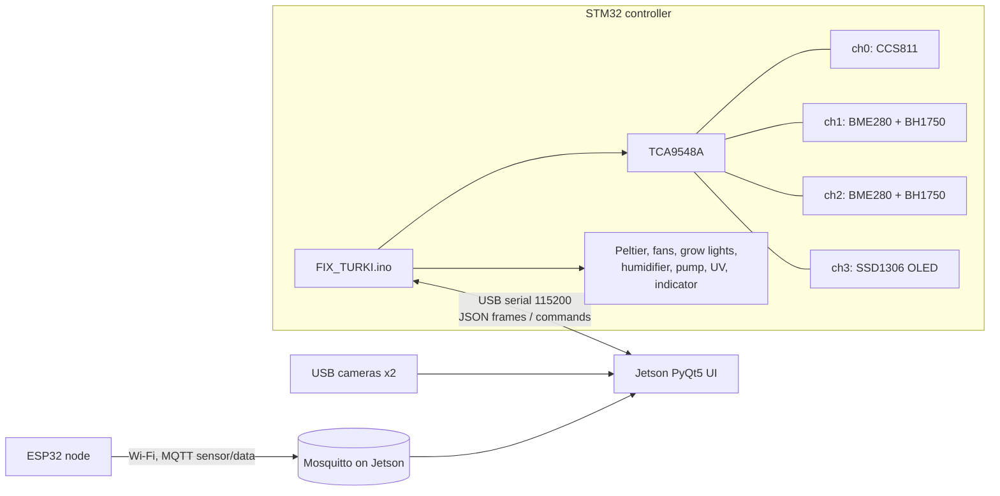

# R2C goes to Turkey: Smart Plant-Growth Chamber

Firmware and Jetson control software for R2C UKSW's climate-controlled plant-growth chamber, built for the TEKNOFEST Agriculture competition in Turkey.

<!-- TODO: add demo GIF/photo of the chamber and the control UI -->

## Overview

R2C (Robotics Research Center, Universitas Kristen Satya Wacana) built an enclosed growth chamber that regulates temperature, humidity and light for plants. This repository holds the full stack:

- **STM32 controller** (`stm/`): reads redundant environmental sensors through an I2C multiplexer, filters them, drives the actuators and talks to the Jetson over USB serial.
- **Jetson UI** (`jetson/`): PyQt5 desktop app for monitoring and manual control, plus two camera feeds.
- **ESP32 node** (`esp/`): wireless sensor node that publishes readings over MQTT to a broker on the Jetson (communication test build).

The PySide6 rewrite of the Jetson UI lives in [TEKNOFEST-JETSON-Program](https://github.com/altilize/TEKNOFEST-JETSON-Program).

## Features

- Dual BME280 and dual BH1750 sensors averaged for temperature, humidity and light, plus a CCS811 for eCO2 and TVOC
- Exponential moving-average filter (alpha = 0.15) on every channel, with a -0.5 °C calibration offset
- TCA9548A I2C multiplexer so identical-address sensors can share one bus
- Non-blocking main loop: command parsing, 2 s sensor publish, 4 s OLED page rotation
- Peltier cooling with H-bridge PWM, Peltier and radiator fans, red and blue grow lights (PWM), humidifier, water pump, UV lamp and indicator light
- Jetson UI with ON/OFF toggles, 0-255 PWM sliders, live gauges, serial port management and two OpenCV camera views

## Architecture



### Serial protocol

Commands from the Jetson are a single letter, optionally followed by a value and a newline:

| Command | Action |
|---|---|
| `S` | Send a sensor frame now |
| `U1`/`U0`, `H1`/`H0`, `W1`/`W0`, `L1`/`L0` | UV light, humidifier, water pump, indicator light on/off |
| `P<n>`, `R<n>`, `D<n>` | Peltier fan, radiator fan, Peltier drive PWM (0-255) |
| `G<n>`, `B<n>` | Red and blue grow light PWM (0-255) |

Sensor frame sent by the STM32:

```json
{"co2":455,"tvoc":15,"temp":25.72,"hum":65.50,"lux":850.0}
```

### Actuator pin map (STM32)

| Pin | Actuator |
|---|---|
| PB4 | Indicator light |
| PB7 | UV light |
| PB10 / PA6 | Grow light red / blue (PWM) |
| PB6 | Humidifier |
| PB5 | Water pump |
| PB15 / PA8 | Peltier RPWM / LPWM |
| PB13 / PB14 | Peltier fan / radiator fan (PWM) |
| PB9 / PB8 | I2C SDA / SCL |

## Tech stack

- **MCUs:** STM32 (Arduino STM32duino core), ESP32
- **Host:** NVIDIA Jetson, Python 3, PyQt5, OpenCV, pyserial, paho-mqtt, Mosquitto
- **Sensors:** BME280 x2, BH1750 x2, CCS811, SSD1306 OLED, TCA9548A multiplexer

## Repository structure

```
stm/                    STM32 chamber controller
  FIX_TURKI.ino         Main loop, JSON output, OLED pages
  pin.h                 Pin map, sensor objects, TCA9548A helper
  sensor.h              Sensor init and EMA filtering
  aktuator.h            Actuator init and serial command parser
esp/
  program_pembacaan_sensor/   ESP32 MQTT sensor node
jetson/                 PyQt5 control UI (main.py entry point)
lib/                    Vendored Arduino libraries (BME280, BH1750, CCS811, GFX, LiquidCrystal_I2C)
INFORMASI_PENTING       Field network notes
```

## Setup

### STM32 firmware

1. Install the STM32duino core in Arduino IDE and copy the folders in `lib/` to your Arduino `libraries/` directory. Also install **Adafruit SSD1306** from the Library Manager.
2. Open `stm/FIX_TURKI.ino`, select your STM32 board and upload.

### ESP32 node (optional)

1. Open `esp/program_pembacaan_sensor/program_pembacaan_sensor.ino`. Install **PubSubClient** and the sensor libraries.
2. Set `ssid`, `password` and `mqtt_server` (the Jetson IP) in `Global.h`, then upload.
3. The current build sends test values; the sensor reads in `loop()` are commented out for communication testing.

### Jetson UI

```bash
cd jetson
python3 -m venv .venv && source .venv/bin/activate
pip install -r requirements.txt
python3 main.py
```

For MQTT, install Mosquitto on the Jetson and add `listener 1883 0.0.0.0` and `allow_anonymous true` to `/etc/mosquitto/mosquitto.conf`.

## My role

Moses Jaguar Ersaptiarso (Firmware & AI Engineer, R2C UKSW) maintained this repository and developed the controller firmware integration, the serial protocol and the Jetson control UI.
